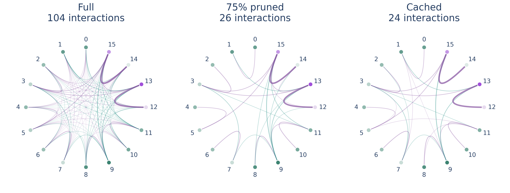
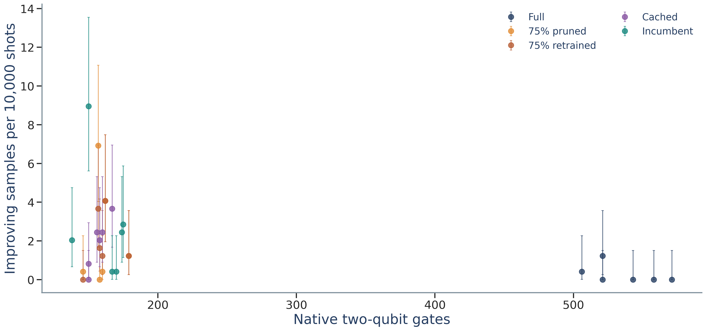
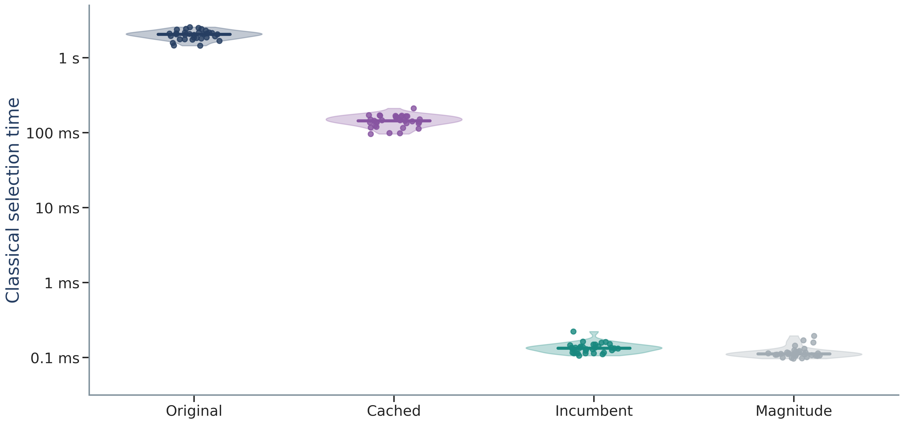

# QAOA-based Lattice Decoding for Post-Quantum Cryptography

**Research code, measured quantum-hardware data, and supplementary figures for a CSE Tech Day student project.**

This project studies a practical question: **how much can we reduce the cost of a QAOA lattice-decoding circuit while retaining useful solutions?** It combines small Module-LWE-derived instances, Babai decoding, sparse QAOA phase operators, and an exactly cached interaction selector. The experiments include ideal simulation, calibrated IBM noise models, and two runs on IBM Marrakesh.

The contribution is an empirical improvement to a QAOA implementation on small, verifiable problems. It is **not an attack on secure ML-KEM, a demonstration of quantum advantage, or a claim that QAOA beats the strongest classical decoder**.



*The same 16-qubit instance, FRESH-0057, with 104, 26, and 24 retained interactions. These are logical coupling graphs, not the processor's physical connectivity. [Vector PDF](figures/F05_quantum_interaction_orbits.pdf) · [Figure data](figures/F05_quantum_interaction_orbits_data.json)*

[Results](#results-at-a-glance) · [Quick start](#quick-start) · [Figure gallery](figures/README.md) · [Method](docs/METHOD.md) · [Reproduction guide](docs/REPRODUCIBILITY.md) · [Experiment index](docs/EXPERIMENTS.md) · [Limitations](docs/LIMITATIONS.md)

## Results at a glance

| Question | Observed result | Scope and evidence |
|---|---|---|
| Can sparsification reduce hardware circuit cost? | **70.39% fewer mean native CZ gates:** 527.75 → 156.25 | Full versus 75% magnitude-pruned QAOA on eight selected IBM Marrakesh cases; [hardware results](results/complete_results.json) |
| Does the sparse circuit still produce useful solutions? | **7/8 reference optima**, retaining Babai, versus **4/8** for full QAOA | Descriptive best-of-samples outcomes on a selected cohort; not population accuracy |
| Can the same selection rule run faster? | **14.02× faster selection**, 95% paired-bootstrap interval **13.63–14.40×** | 32 cases, five interleaved timing repetitions; identical masks and paths on 128 fresh cases; [EXP-023](experiments/runs/EXP-023_20261020T180743053982+0530/summary.json) |
| What happens under a calibrated noise model? | Expected 1,024-sample hybrid success **87.14% → 88.42%**; retrained sparse variant **88.65%** | 512-case IBM Fez simulation, not hardware; [EXP-008](experiments/runs/EXP-008_20261020T050837222393+0530/summary.json) |

Caching speeds up the **original objective-guided selector**, not the entire decoder. It does not introduce a new pruning principle. Cheap selectors and classical local refinement remain important, often stronger controls; their results are included below and throughout the archive.

## Actual quantum-hardware experiment

- **Device:** IBM Marrakesh; 16 logical qubits, QAOA depth $p=1$.
- **Runs:** two jobs on 20 October 2026, using **280 QPU seconds** in total.
- **Measurements:** **983,040 shots**, or 24,576 shots per case and method after pooling.
- **Cohort:** eight prespecified instances: six seeded selections from Babai failures and two random sentinels.
- **Protocol:** five frozen methods. The second job was a fixed precision extension after the initial results; pooled results are descriptive.

| Method | Mean native CZ | Samples improving on Babai¹ | Reference optima attained² |
|---|---:|---:|---:|
| Babai alone | 0 | — | 2/8 |
| Full QAOA | 527.750 | 4 | 4/8 |
| 75% magnitude pruning, unchanged angles | 156.250 | 32 | 7/8 |
| 75% magnitude pruning, retrained angles | 156.250 | 29 | 7/8 |
| Cached objective-guided selection, K=24 | 155.375 | 28 | 7/8 |
| Cheap incumbent-informed selection, K=24 | 160.125 | 42 | 8/8 |
| Classical one-coordinate refinement | 0 | — | 4/8 |
| Classical two-coordinate refinement | 0 | — | 8/8 |

¹ Each quantum method has 147,456 shots across the six difficult cases. Improving-event counts are distinct from exact-optimum counts.  
² Each hybrid retains the Babai incumbent. These selected-case fractions are **not** estimates of performance on arbitrary instances.



*Measured hardware resource–quality comparison. The complete figure includes the inexpensive incumbent-informed control and uncertainty. [Vector PDF](figures/F09_hardware_resource_quality.pdf) · [Figure data and metric definition](figures/F09_hardware_resource_quality_data.json)*

The independent hardware audit reconstructs integer lattice costs from the measured bitstrings and checks all **983,040 shots**, 80 circuit measurement maps, and the recorded frozen-file hashes. Improving outcomes are rare. Bootstrap intervals can be optimistic with zero counts; conservative exact simultaneous bounds are also provided and include zero for the average difference. See [statistical interpretation](docs/LIMITATIONS.md) and the [pooled analysis](experiments/runs/EXP-028_20261020T221336422019+0530/pooled_analysis_20261020T223051213990+0530/summary.json).

## Classical selection cost

The cached implementation reuses trigonometric terms in the analytic $p=1$ expectation. It follows the same greedy deletion path and magnitude fallback as the original selector, including a check for near-tied decisions.



*All 32 per-case medians are shown; the vertical axis is logarithmic. The cached implementation accelerates its original rule, while the cheap controls remain much faster. [Vector PDF](figures/F03_selection_raincloud.pdf) · [Raw plotted values](figures/F03_selection_raincloud_data.json)*

At nearly matched native gate budgets, the fresh 128-group calibrated-noise comparison did **not** establish cached-selector superiority over the cheap incumbent-informed rule: the primary difference was −0.7422 percentage points, with a 95% interval of [−1.6268, +0.0832]. [Full comparison](docs/RESULTS.md#matched-native-budget-comparison)

## Quick start

The original research environment used **Python 3.14.3**. Exact recorded package versions are in [requirements-research.txt](requirements-research.txt); per-run manifests preserve their environments. Run commands from the repository root. Qiskit Aer wheel availability depends on your Python version and operating system.

```bash
git clone https://github.com/orisus42/QAOA-based-Lattice-Decoding.git
cd QAOA-based-Lattice-Decoding
python -m venv .venv
```

Activate with `.venv\Scripts\Activate.ps1` on Windows PowerShell, or `source .venv/bin/activate` on macOS/Linux. Then:

```bash
python -m pip install -r requirements-research.txt
python -m pytest -q
python examples/small_decoding_demo.py
python scripts/verify_release.py
python scripts/verify_hardware_release.py
```

The demo and verification commands run **locally**, require no IBM account, and submit no jobs. The demo illustrates the bounded search and reports its actual outcome; it is not a benchmark or an expectation of a quantum win. [Detailed reproduction instructions](docs/REPRODUCIBILITY.md)

## Repository map

| Location | Contents |
|---|---|
| [src/lattice_qaoa/](src/lattice_qaoa/) | Polynomial instances, exact references, encoding, QAOA, pruning, caching, and noise utilities |
| [examples/](examples/) | Small offline decoding example |
| [tests/](tests/) | Algebra, encoding, statevector/analytic consistency, pruning, and numerical checks |
| [experiments/configs/](experiments/configs/) | Recorded seeds, parameters, budgets, and evaluation protocols |
| [experiments/runs/](experiments/runs/) | Historical results, per-instance tables, source snapshots, manifests, audits, and failures |
| [results/](results/) | Convenient consolidated tables and evidence summaries |
| [figures/](figures/README.md) | Eleven scientific figures, each with PNG, PDF, SVG, and data/interpretation JSON |
| [circuits/](circuits/) | Compact and expanded LaTeX quantum-circuit diagrams and parameters |
| [docs/](docs/REPRODUCIBILITY.md) | Methods, results, limits, bibliography, experiment catalogue, and reproduction guide |
| [reproducibility/](reproducibility/) | File hashes, export provenance, release validation, and an explicit omitted-intermediates inventory |
| [research/reference_sources/](research/reference_sources/) | Pinned educational kyber-py source and NIST ACVP key-generation vectors with provenance |
| [pilot/](pilot/) and [outputs/](outputs/) | Earlier **generic q-ary** exploratory pilot, kept separate from Module-LWE evidence |

This is a curated research release, not a dump of the author's working directory. All measured hardware counts, ordered samples, and submitted circuits are included. Large **derived simulator binaries** are catalogued but omitted; their sources, seeds, configurations, and reported results remain available. See [what is included and omitted](docs/REPRODUCIBILITY.md#archive-boundaries).

## Connection to post-quantum cryptography

The toy instances preserve polynomial multiplication in a negacyclic ring and a module structure related to Module-LWE. The main decoding family uses $n=2, k=2, q=17, \eta=2$, an eight-dimensional augmented lattice, and a 16-qubit bounded encoding. It is far smaller than secure ML-KEM.

A separate provenance study checks the full-size ML-KEM key-generation equations against 75 pinned NIST ACVP examples. **That check verifies the algebraic connection; it does not solve those secure-size instances.** The decoded examples remain small analogues. The squared-distance objective is a surrogate for the noise/secret prior, not exact maximum-likelihood decoding. [Method and provenance](docs/METHOD.md)

## References and reuse

The bibliography covers Babai's nearest-plane algorithm, fixed-angle QAOA for constrained CVP, sparsified phase operators, analytic QAOA expectation values, and FIPS 203. See [references](docs/REFERENCES.md) and [third-party notices](THIRD_PARTY_NOTICES.md). Cite this repository at the commit you used; [CITATION.cff](CITATION.cff) provides author and project metadata.

An original-project redistribution license has not yet been selected by the author; publication alone should not be treated as an unrestricted license. Vendored material retains its upstream notices. This is experimental research software, not a production cryptographic implementation.

## AI assistance disclosure

OpenAI Codex assisted with literature exploration, research planning and discussion, implementation and debugging, simulation and analysis code, test development, scientific plotting, documentation, repository organization, and editorial poster drafts. This README and other release documentation were prepared with that assistance. The poster's final wording was reserved for the student under the event's stated authorship requirement; this repository does not certify which draft was ultimately submitted.

AI-generated suggestions were not treated as experimental evidence. Reported numerical results are linked to saved computations or measured hardware outputs and accompanying checks. Those checks reduce error risk but do not establish independent peer review, novelty, quantum advantage, or cryptanalytic relevance at secure parameters. Scientific interpretation and publication responsibility remain with the author, Shriyansh Aggarwal.
