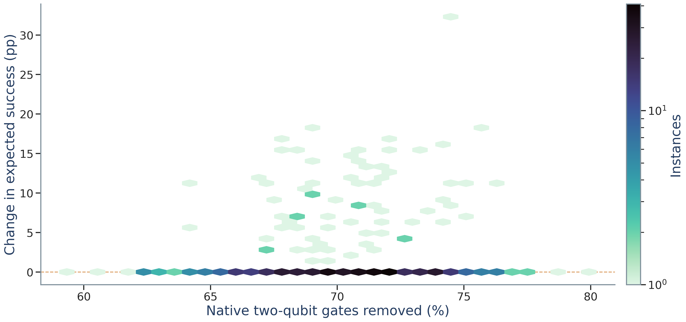
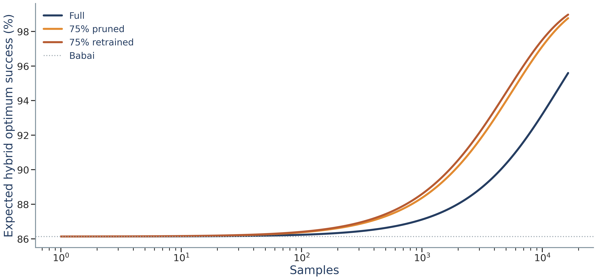
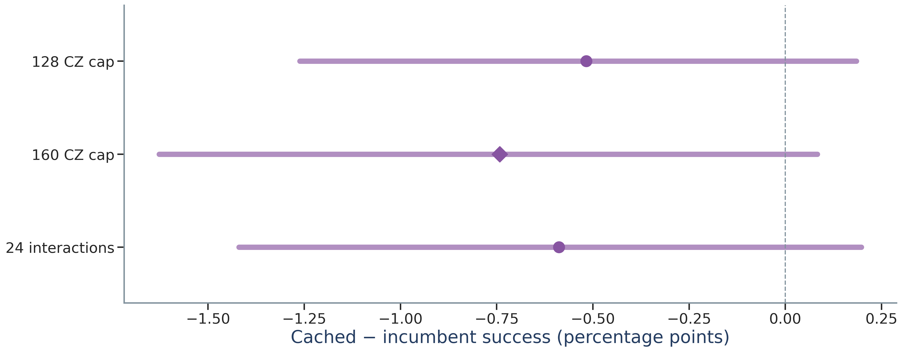
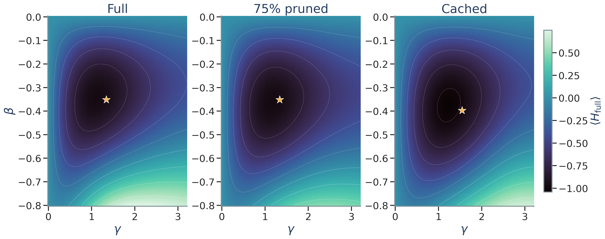
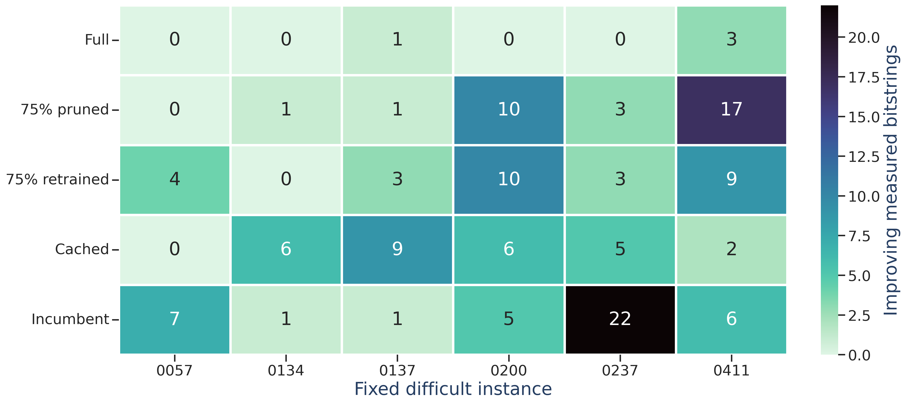
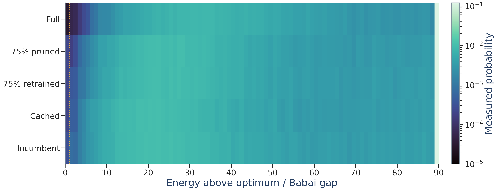
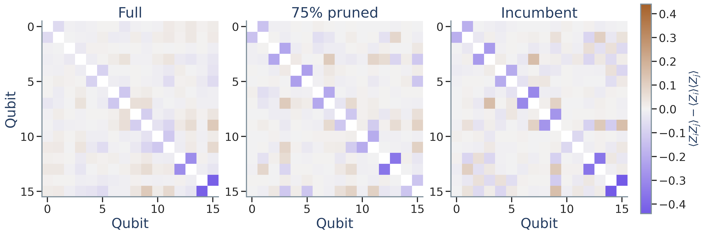
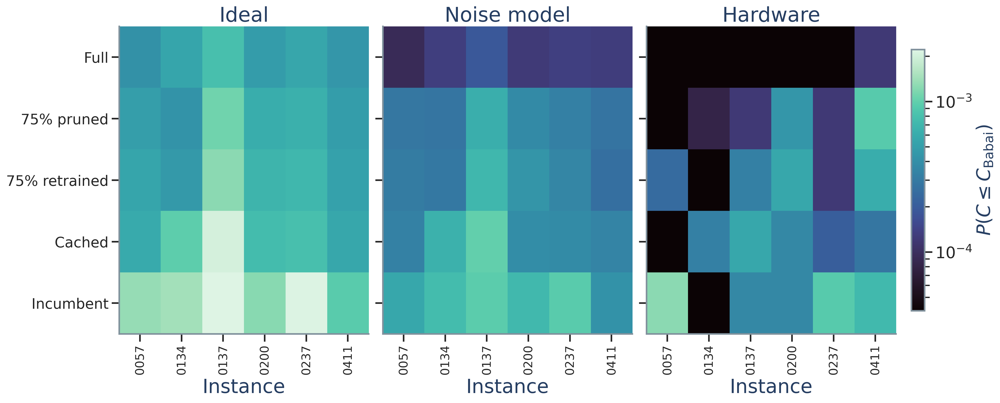

# Supplementary figure gallery

Every figure has a PNG preview, vector-friendly PDF/SVG export, and a JSON file recording data and interpretation. Some heatmap components may be rasterized inside a PDF. Saved uncertainty and less favorable controls are retained.

These figure IDs are stable archive identifiers; they need not match the numbering on the final poster.

| ID | Figure | Downloads |
|---|---|---|
| F01 | [Paired gate-cost / solution-quality atlas](#f01) | [PNG](F01_gate_quality_atlas.png) · [PDF](F01_gate_quality_atlas.pdf) · [SVG](F01_gate_quality_atlas.svg) · [Data](F01_gate_quality_atlas_data.json) |
| F02 | [Dense predicted sample-budget response](#f02) | [PNG](F02_dense_shot_response.png) · [PDF](F02_dense_shot_response.pdf) · [SVG](F02_dense_shot_response.svg) · [Data](F02_dense_shot_response_data.json) |
| F03 | [Selector timing distributions](#f03) | [PNG](F03_selection_raincloud.png) · [PDF](F03_selection_raincloud.pdf) · [SVG](F03_selection_raincloud.svg) · [Data](F03_selection_raincloud_data.json) |
| F04 | [Strong matched-budget control](#f04) | [PNG](F04_strong_control.png) · [PDF](F04_strong_control.pdf) · [SVG](F04_strong_control.svg) · [Data](F04_strong_control_data.json) |
| F05 | [Quantum interaction orbits](#f05) | [PNG](F05_quantum_interaction_orbits.png) · [PDF](F05_quantum_interaction_orbits.pdf) · [SVG](F05_quantum_interaction_orbits.svg) · [Data](F05_quantum_interaction_orbits_data.json) |
| F06 | [QAOA phase-angle landscapes](#f06) | [PNG](F06_qaoa_phase_landscape.png) · [PDF](F06_qaoa_phase_landscape.pdf) · [SVG](F06_qaoa_phase_landscape.svg) · [Data](F06_qaoa_phase_landscape_data.json) |
| F07 | [Measured improving-sample map](#f07) | [PNG](F07_hardware_event_map.png) · [PDF](F07_hardware_event_map.pdf) · [SVG](F07_hardware_event_map.svg) · [Data](F07_hardware_event_map_data.json) |
| F08 | [Measured cost-distribution carpet](#f08) | [PNG](F08_quantum_energy_carpet.png) · [PDF](F08_quantum_energy_carpet.pdf) · [SVG](F08_quantum_energy_carpet.svg) · [Data](F08_quantum_energy_carpet_data.json) |
| F09 | [Hardware resource / quality comparison](#f09) | [PNG](F09_hardware_resource_quality.png) · [PDF](F09_hardware_resource_quality.pdf) · [SVG](F09_hardware_resource_quality.svg) · [Data](F09_hardware_resource_quality_data.json) |
| F10 | [Measured connected Z correlations](#f10) | [PNG](F10_measured_Z_correlations.png) · [PDF](F10_measured_Z_correlations.pdf) · [SVG](F10_measured_Z_correlations.svg) · [Data](F10_measured_Z_correlations_data.json) |
| F11 | [Ideal / calibrated-noise / hardware comparison](#f11) | [PNG](F11_prediction_to_hardware.png) · [PDF](F11_prediction_to_hardware.pdf) · [SVG](F11_prediction_to_hardware.svg) · [Data](F11_prediction_to_hardware_data.json) |

## F01: Paired gate-cost / solution-quality atlas

512 paired cases;75% unchanged-angle versus full at1024 shots, saved Fez model. Hexagonal bins show actual observations, not a fitted advantage boundary. Most Babai-optimal cases have zero hybrid difference.

## F02: Dense predicted sample-budget response

400 analytical evaluations of mean[1-(1-p_i)^N], retaining Babai per instance. Conditional on saved finite-trajectory probabilities; curves are model predictions, not400 independent experiments. No interpolation between a few shot outcomes.

## F03: Selector timing distributions

32 cases; each point is the median of5 interleaved repetitions. Violin density is descriptive in log time; all raw points shown. Cheap methods remain much faster. Cached/original circuits validated separately.

## F04: Strong matched-budget control

128 fresh groups; paired95% group+Monte-Carlo intervals. Diamond is prespecified primary. Preserve this null/unfavorable comparison. Connecting observations into a smooth curve would be invalid.

## F05: Quantum interaction orbits

Actual submitted logical Ising couplings. Same16-qubit circular layout in all panels; edge width reflects|J|,edge color sign,node color local field. This is a logical interaction graph, not physical hardware topology.

## F06: QAOA phase-angle landscapes

Exact p=1 analytic expectation of the ORIGINAL normalized full Hamiltonian on a121x101 grid. Stars show frozen submitted angles, not newly optimized ones. Same color scale across panels; diagnostic on one preselected case.

## F07: Measured improving-sample map

Actual hardware strict improvements over Babai, equal shots per cell. Six conditional failure cases, not a population accuracy estimate. Rare events require intervals in supporting table.

## F08: Measured cost-distribution carpet

Measured cost populations, averaged equally over six difficult cases. Original full objective used for every method. Gold line marks Babai cost; final bin includes overflow. Log color floor is only display, raw probabilities preserved.

## F09: Hardware resource / quality comparison

Actual hardware per-case strict-improvement frequencies with exact95% binomial intervals. Gate counts paired by case; curves would be inappropriate for these discrete policies. Conditional6-case cohort.

## F10: Measured connected Z correlations

Measured connected Z-basis correlations on the first prespecified difficult case. Diagonal masked. Same color scale. Classical correlations and noise can produce this pattern; it is not an entanglement witness or proof of quantum advantage.

## F11: Ideal / calibrated-noise / hardware comparison

Exact ideal probabilities,64-trajectory fresh Marrakesh calibration model, and actual pooled hardware frequencies for the same frozen circuits. Shared log color scale; zero values use the display floor. Model mismatch is retained, not recalibrated to results. Uncertainty is in supporting per-circuit records.

